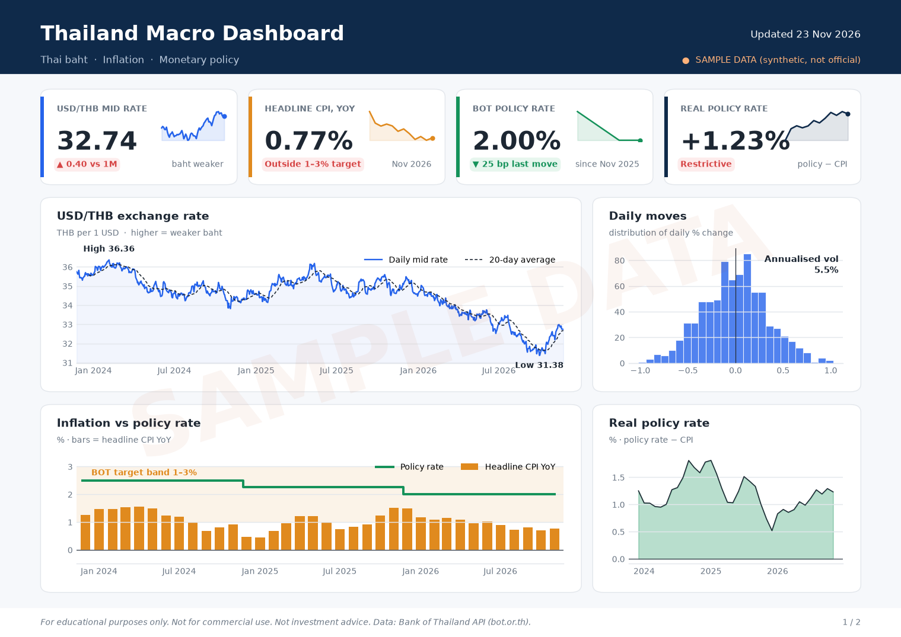
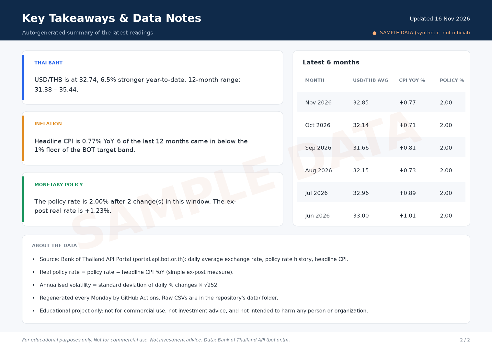

# 🇹🇭 Thailand Macro Dashboard: ค่าเงินบาท · เงินเฟ้อ · ดอกเบี้ยนโยบาย

> ⚠️ **คำเตือน / Disclaimer**
> โปรเจกต์นี้ทำขึ้น **เพื่อการศึกษาเท่านั้น** ไม่ได้ใช้ในเชิงพาณิชย์ ไม่ใช่คำแนะนำการลงทุน
> และไม่ได้มีเจตนาทำให้บุคคลหรือองค์กรใดเสียหาย ข้อมูลเป็นของธนาคารแห่งประเทศไทย (ธปท.)
> โปรดตรวจสอบตัวเลขกับแหล่งข้อมูลทางการก่อนนำไปใช้ทุกครั้ง
>
> *For educational purposes only. Not for commercial use, not investment advice, and not
> intended to harm any person or organization. Data belongs to the Bank of Thailand.*

ดึงข้อมูลจาก [BOT API Portal](https://portal.api.bot.or.th) ด้วย Python แล้วสร้าง dashboard เป็นไฟล์ **PDF** (A4)

## 📄 ผลลัพธ์ (Output)

**[👉 เปิด PDF dashboard](output/thai_econ_dashboard.pdf)** (GitHub แสดง PDF ในเบราว์เซอร์ได้เลย)

> ℹ️ มุมขวาบนของรายงานบอกแหล่งข้อมูลเสมอ จุดสีเขียว "Bank of Thailand API" คือข้อมูลจริง จุดสีส้ม "SAMPLE DATA" คือข้อมูลตัวอย่างที่สร้างขึ้นเอง

**หน้า 1: Overview**



**หน้า 2: Key takeaways & data notes**



ข้อมูลดิบ (CSV): [`data/`](data/)

## 📊 สิ่งที่อยู่ใน Dashboard
| ส่วน | ข้อมูล |
|---|---|
| KPI | อัตราแลกเปลี่ยน USD/THB ล่าสุด, เงินเฟ้อทั่วไป (YoY), ดอกเบี้ยนโยบาย, ดอกเบี้ยแท้จริง |
| กราฟ 1 | USD/THB รายวัน + ค่าเฉลี่ย 20 วัน |
| กราฟ 2 | การกระจายตัวของการเปลี่ยนแปลงรายวัน (ความผันผวน) |
| กราฟ 3 | เงินเฟ้อเทียบกรอบเป้าหมาย 1–3% และดอกเบี้ยนโยบาย |
| กราฟ 4 | ดอกเบี้ยนโยบายแท้จริง (policy rate − CPI) |

## 🚀 วิธีใช้
```bash
pip install -r requirements.txt
```
1. สมัครและขอ token ฟรีที่ https://portal.api.bot.or.th
2. ตั้งค่า environment variable `BOT_API_TOKEN`:
```bash
export BOT_API_TOKEN="your-token"      # Windows PowerShell: $env:BOT_API_TOKEN="your-token"
```
3. รันสคริปต์:
```bash
python src/dashboard.py
```
ไฟล์จะออกที่ `output/thai_econ_dashboard.pdf`

ถ้าไม่มี token, API ตอบ error หรือค่าเงินบาทล่าสุดเก่ากว่า 7 วัน สคริปต์จะหยุดพร้อมบอกสาเหตุ และไม่เขียนไฟล์ใดเลย

ถ้าอยากลองโดยไม่มี token ให้รัน `python src/dashboard.py --sample` รายงานจะใช้ **ข้อมูลตัวอย่าง (synthetic)** และประทับคำว่า `SAMPLE DATA` ข้อมูลนี้ **ไม่ใช่ตัวเลขจริงของ ธปท.** อย่า commit ผลที่ได้

ถ้า ธปท. เปลี่ยน path ของ API ให้แก้ผ่าน env ได้: `BOT_EXG_PATH`, `BOT_POLICY_PATH`, `BOT_OBS_PATH`, `BOT_CPI_SERIES`

## 🔄 อัปเดตอัตโนมัติด้วย GitHub Actions
Workflow ใน `.github/workflows/update.yml` จะสร้าง PDF ใหม่ทุกวันจันทร์แล้ว commit กลับเข้า repo
ให้เพิ่ม secret ชื่อ `BOT_API_TOKEN` ที่ **Settings → Secrets and variables → Actions**

ถ้าดึงข้อมูลจริงไม่ได้ workflow จะขึ้นสีแดงและไม่ commit อะไร ไฟล์เดิมใน repo จึงไม่ถูกเขียนทับ

## 🗂️ โครงสร้าง
```
src/bot_api.py      # client เรียก BOT API
src/sample_data.py  # ข้อมูลตัวอย่างสำหรับรันแบบออฟไลน์
src/theme.py        # design system (สี ฟอนต์ การ์ด)
src/dashboard.py    # สร้างกราฟ + PDF 2 หน้า + PNG preview
output/             # PDF และรูป preview
data/               # CSV ที่ดึงมา
```

## 📜 License
[MIT](LICENSE). ข้อมูลเศรษฐกิจเป็นลิขสิทธิ์ของธนาคารแห่งประเทศไทย ใช้ตามเงื่อนไขของ BOT API Portal
